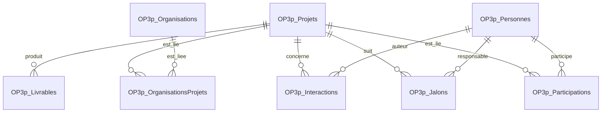

# Modèle relationnel OP3p V0.1 — Contrat de données

Les tables sont définies **exclusivement dans** `src/schema.js` ; ce fichier est la source du schéma. Les noms de table et de colonne (identifiants techniques) doivent être stables.

## Schéma logique

## Tables et colonnes

| Table | Colonnes (hors `id`, colonne interne Grist) |
|---|---|
| `OP3p_Projets` | `Code` Text, `Titre` Text, `Description` Text, `Statut` Choice, `Date_Debut` Date, `Date_Fin` Date, `Axe` Text, `Domaine_Innovation` Text, `TRL` Int, `Notes` Text |
| `OP3p_Personnes` | `Nom` Text, `Prenom` Text, `Email` Text, `Fonction` Text, `Notes` Text |
| `OP3p_Organisations` | `Nom` Text, `Sigle` Text, `Type` Choice, `Site_Web` Text, `Notes` Text |
| `OP3p_Participations` | `Projet` Ref:OP3p_Projets, `Personne` Ref:OP3p_Personnes, `Role` Choice, `Date_Debut` Date, `Date_Fin` Date |
| `OP3p_OrganisationsProjets` | `Projet` Ref:OP3p_Projets, `Organisation` Ref:OP3p_Organisations, `Role` Choice |
| `OP3p_Jalons` | `Projet` Ref:OP3p_Projets, `Titre` Text, `Date_Cible` Date, `Date_Realisation` Date, `Statut` Choice, `Responsable` Ref:OP3p_Personnes, `Notes` Text |
| `OP3p_Livrables` | `Projet` Ref:OP3p_Projets, `Titre` Text, `Date_Prevue` Date, `Date_Remise` Date, `Statut` Choice, `Notes` Text |
| `OP3p_Interactions` | `Projet` Ref:OP3p_Projets, `Date_Action` Date, `Type` Choice, `Resume` Text, `Auteur` Ref:OP3p_Personnes |

`id` est l'identifiant technique des lignes Grist, distinct du code métier `OP3p_Projets.Code`. Les colonnes `Ref:` stockent l'**ID de ligne Grist**, pas le texte affiché d'une personne ou du projet.

## Cardinalités

- Un projet peut avoir **0 à N participations** ; une personne peut participer à **0 à N projets**. Une ligne de `OP3p_Participations` signifie un **rôle** précis d'une personne dans un projet.
- Un projet peut être lié à **0 à N organisations**, une organisation à **0 à N projets**.
- Un projet peut comprendre **0 à N jalons**, **0 à N livrables**, **0 à N interactions**.
- Chaque jalon ne possède qu'un responsable principal dans ce prototype (champ facultatif). Plusieurs responsables exigeront une nouvelle table de liaison ou un modèle différent.

## Règles métier initiales (à valider)

- Code projet obligatoire et distinct de ceux existants, comparaison insensible à la casse (validation *côté widget*, pas index unique en base).
- Titre du projet obligatoire. Date de fin non antérieure à la date de début.
- TRL facultatif, entier entre 1 et 9 ; à définir plus précisément (TRL actuel vs cible, date d'évaluation).
- Projet considéré comme actif seulement si statut `En cours` ou `Prolongé`, à confirmer avec le CIEDS.
- Jalon en retard si sa date cible est antérieure à la date du jour **et** son statut différent de `Terminé`.
- Déduplication *côté widget* des couples `(Projet, Personne, Rôle)` et `(Projet, Organisation, Rôle)`.
- Aucun champ `Est_Principal` n'est rendu obligatoire : aucune règle d'unicité de priorité n'a encore été validée.

## Choix de modélisation et dette technique explicite

1. `Axe` et `Domaine_Innovation` sont **Text** en V0.1 pour démarrer rapidement. Cette décision ne représente pas encore le modèle de référence final. Si un projet peut relever de plusieurs axes, migrer vers `OP3p_Axes` et `OP3p_ProjetsAxes` (relation N–N) en conservant l'historique.
2. `Statut` et `Role` sont des colonnes Choice. Dans une version pérenne, envisager des tables de nomenclature pour éviter des règles dispersées.
3. Pas de suivi avancé des recrutements/contrats, personnels non permanents ou budgets tant que les responsabilités de mise à jour et habilitations ne sont pas définies.
4. `Interactions` est un historique *déclaratif*. Ce n'est **pas** un journal d'audit automatique et inviolable de toutes les modifications.
5. La suppression de projets/personnes/organisations n'est pas proposée dans le widget. Les historiques et associations ne sont pas supprimés en cascade. La gestion de leur cycle de vie est à définir.
6. L'intégrité référentielle et les règles d'unicité doivent être contrôlées côté Grist ou par procédure de gouvernance si d'autres utilisateurs modifient directement les tables.
7. Une interface actuellement connectée au document entier peut lire les tables accessibles à l'utilisateur : les règles d'accès Grist priment.

## Évolution du schéma et migration

- Créer une copie du document DEV avant toute migration.
- Écrire un script de migration versionné (futur `migrations/`) pour les nouvelles tables/colonnes.
- Ne jamais supprimer / renommer brutalement les colonnes utilisées par le widget.
- Maintenir des IDs métiers stables : `Code` projet, éventuellement identifiants persistants pour personnes/organisations.
- Tester données existantes, imports, références et ACL après migration.
